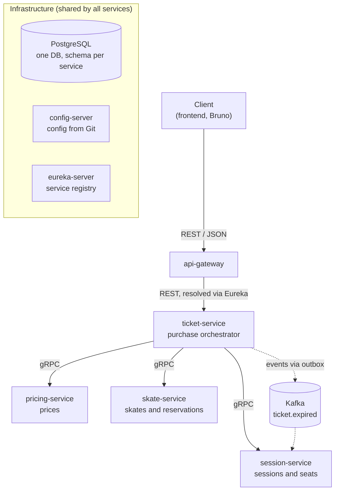
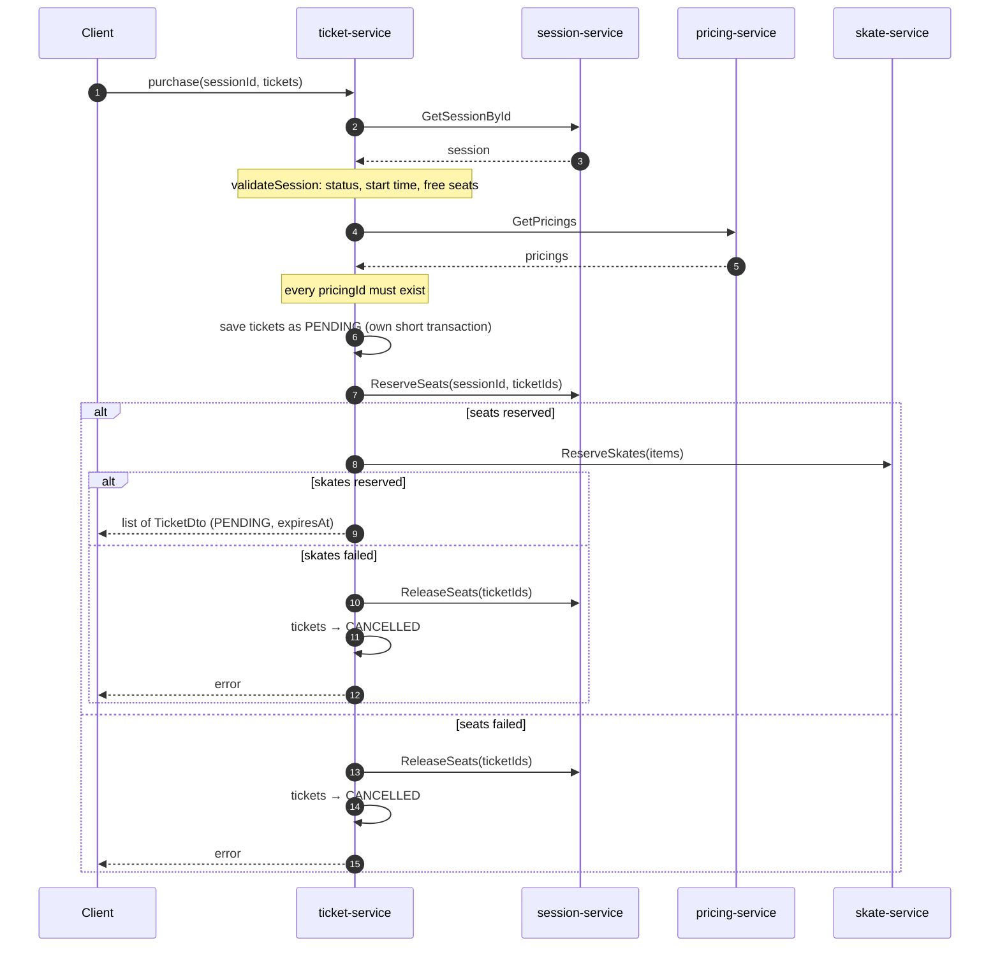
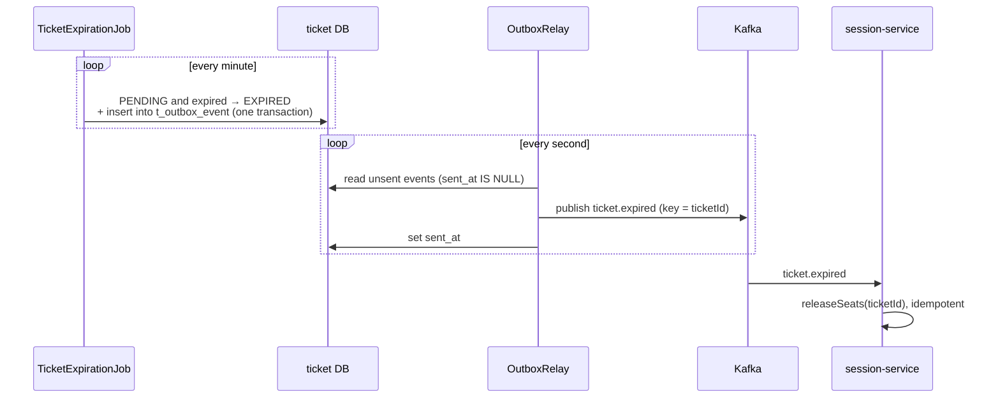
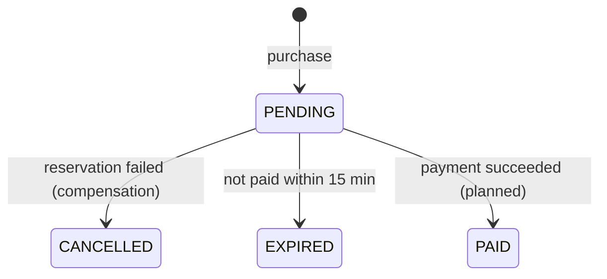
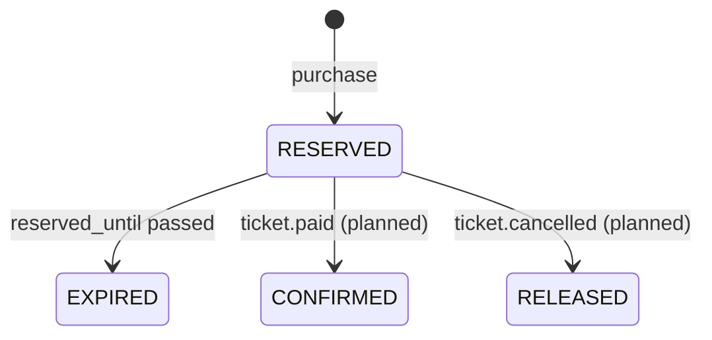
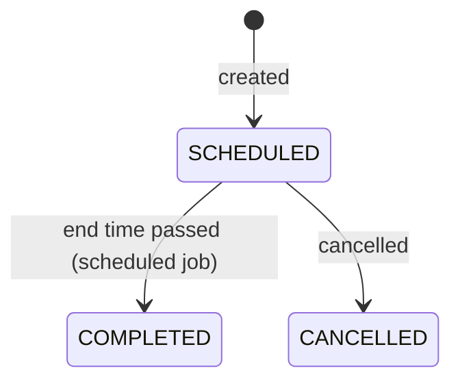

# Ice Skate

A microservice backend for an ice rink: users buy tickets for skating sessions, optionally rent skates, and pay within a time limit. This README describes how the services are structured, how they talk to each other, and how a ticket purchase flows through the system.

**Stack:** Java 25 · Spring Boot 4.1 · Spring Cloud (Config, Eureka, Gateway) · Spring gRPC · Spring for Apache Kafka · PostgreSQL · Flyway · Docker Compose

> This document describes the design decisions and the logic as implemented. If the code and this README ever disagree, the code wins — please update the README.

## Contents

- [Architecture overview](#architecture-overview)
- [How services communicate](#how-services-communicate)
- [Infrastructure and configuration](#infrastructure-and-configuration)
- [Ticket purchase flow](#ticket-purchase-flow)
- [Seat reservation (session-service)](#seat-reservation-session-service)
- [Skate reservation (skate-service)](#skate-reservation-skate-service)
- [Pricing (pricing-service)](#pricing-pricing-service)
- [Background processes: expiration, outbox and Kafka](#background-processes-expiration-outbox-and-kafka)
- [gRPC contracts and error handling](#grpc-contracts-and-error-handling)
- [Data model](#data-model)
- [Status lifecycles](#status-lifecycles)
- [Known limitations and roadmap](#known-limitations-and-roadmap)
- [Glossary](#glossary)

---

## Architecture overview

Each service owns one part of the domain and stores its data in its own schema of a shared PostgreSQL database. Clients only talk to `api-gateway`; inside the system, services call each other over gRPC and exchange events through Kafka.



### Services

| Service | Responsibility | Role in a purchase |
|---|---|---|
| `api-gateway` | Single entry point for clients; resolves services through Eureka | Forwards the request to `ticket-service` |
| `ticket-service` | Tickets: purchase, storage, expiration of unpaid tickets; publishes events | **Orchestrator**: calls the other services, saves tickets, rolls back on failure |
| `session-service` | Skating sessions (date, time, capacity, status) and seat accounting | Returns the session; atomically occupies and releases seats |
| `pricing-service` | Prices (categories and amounts) | Returns prices; the ticket price is computed from them |
| `skate-service` | Skates and their reservations per session | Reserves specific skates for a specific ticket |
| `user-service`, `payment-service` | Users and payments | Not part of the purchase flow yet (see [roadmap](#known-limitations-and-roadmap)) |
| `config-server` | Serves configuration to all services from a Git repository | Infrastructure |
| `eureka-server` | Service registry | Infrastructure |

### Design principles

- **REST outside, gRPC inside.** JSON is convenient for clients; between services a strict contract and a compact binary format matter more.
- **Synchronous when someone is waiting for the answer.** The user must know immediately whether seats and skates are available, so reservations go over gRPC.
- **Asynchronous when nobody is waiting.** Releasing seats after a ticket expires is an event published through Kafka.
- **Race conditions are handled by the database.** Double booking is prevented by an atomic `UPDATE` and a unique index, not by checks in Java.
- **Everything temporary expires on its own.** Tickets and skate reservations have a TTL, so nothing gets stuck forever even if a service crashes.
- **Retries are safe.** Release operations are idempotent: calling them twice changes nothing.

---

## How services communicate

| Mechanism | Where | Why |
|---|---|---|
| REST / JSON | Client → `api-gateway` → `ticket-service` | Easy for browsers and tools like Bruno |
| gRPC (protobuf over HTTP/2) | `ticket-service` → `session`, `pricing`, `skate` | The answer is needed right away; strict `.proto` contract; compact binary format |
| Kafka events | `ticket-service` → `session-service` (`ticket.expired`) | No answer needed; the event is not lost even if the consumer is temporarily down |

**Why gRPC rather than OpenFeign.** The contract lives in `.proto` files, client and server code are generated, and Spring Boot 4.1 supports gRPC with first-party starters (`spring-boot-starter-grpc-server`, `spring-boot-starter-grpc-client`). The trade-offs are a separate gRPC port, code generation at build time, and debugging with grpcurl / IntelliJ HTTP Client instead of a plain REST client.

**Why reservations are not done through Kafka.** "Are the seats and skates free?" is a question the user is waiting on. Over Kafka the answer would arrive later as a separate event, requiring a "processing" status and polling on the frontend. So the design is hybrid: reservations are synchronous gRPC calls, and everything that happens *after* the purchase (expiration, cancellation, payment) is event-driven.

### Locating gRPC servers

Stubs are registered as Spring beans with `@ImportGrpcClients` (or an explicit `@Bean` built from `GrpcChannelFactory`). Each stub is bound to a logical channel name; the real address comes from configuration:

```properties
spring.grpc.client.channel.pricing.target=static://localhost:9090
spring.grpc.client.channel.session.target=static://localhost:4842
spring.grpc.client.channel.skate.target=static://localhost:<skate-service gRPC port>
```

`static://` means "connect directly to this address". Eureka is not used for gRPC — the official client has no built-in Eureka integration. Inside docker-compose, use the container name instead of `localhost`. To run several instances later, switch to `dns:///name:port` with the `round_robin` load-balancing policy.

> **Every gRPC call has a 2-second deadline** (`withDeadlineAfter`). Without it, if a downstream service hangs, `ticket-service` threads would wait forever and the whole service would stop responding (cascading failure). The deadline is propagated to the server, which also stops working on the call once time is up.

---

## Infrastructure and configuration

### config-server

Service configuration (datasource, Flyway, schemas) is stored in a Git repository and served by `config-server`. Each service imports it on startup:

```properties
spring.config.import=optional:configserver:http://localhost:8888
```

You can check what a service will receive at `http://localhost:8888/<service-name>/default`.

- `config-server` clones the repository to a local folder. By default that is the OS temp folder, which Windows may clean up — after that every request fails with HTTP 500 (`RepositoryNotFoundException`). Set an explicit folder with `spring.cloud.config.server.git.basedir`.
- The import is `optional`: if `config-server` is down, a service still starts, but **without its configuration**. Errors then show up later, for example when connecting to the database.
- Config changes must be committed and pushed; otherwise `config-server` serves the old version.

### eureka-server

Service registry. `api-gateway` uses it to find `ticket-service` and other services over REST. Some services use a random HTTP port (`server.port=0`), so they could not be found without the registry.

### PostgreSQL: one database, one schema per service

All services use the `ice-skate-db` database, each in its own schema (e.g. `session-service` uses `session_schema`). Tables are created by Flyway from `src/main/resources/db/migration`.

> **Put the schema in the JDBC URL:**
> `jdbc:postgresql://localhost:5000/ice-skate-db?currentSchema=session_schema`
>
> `hibernate.default_schema` only applies to queries Hibernate generates. Native SQL (`nativeQuery = true`) ignores it and looks for tables in `public`, which is why `occupySeats` once failed with `relation "t_session" does not exist`.

### Kafka

Kafka runs in Docker in KRaft mode (no ZooKeeper): a single process acts as both broker and controller. It exposes two client addresses:

| Where the service runs | `spring.kafka.bootstrap-servers` |
|---|---|
| Started from the IDE on the host machine | `localhost:9092` |
| Running inside docker-compose | `kafka:29092` |

Two addresses are needed because, after the first connection, Kafka tells the client which address to use from then on, and that address must be reachable from wherever the client runs. Internal topics use a replication factor of 1 because there is only one broker.

---

## Ticket purchase flow

The purchase is orchestrated by `TicketService.purchaseTickets` in `ticket-service`. It calls the other services, saves the tickets, and rolls back completed steps if something fails.

### Request

One session and a list of tickets. Each ticket has a price category and, optionally, a specific pair of skates (`skateId: null` means no skates):

```json
{
  "userId": 7,
  "sessionId": 21,
  "tickets": [
    { "pricingId": 1, "skateId": 15 },
    { "pricingId": 2, "skateId": null }
  ]
}
```

The request is validated with Bean Validation before it reaches the service (`@Valid` in the controller): `userId` and `sessionId` are `@NotNull`, `tickets` is `@NotEmpty`, and each element is validated through `List<@Valid PurchaseTicketArgs>`.

### Steps



1. **Load and validate the session.** `sessionGrpcClient.getSessionById` + `validateSession` (see below).
2. **Load and validate prices.** `pricingGrpcClient.getPricings` returns all prices as `Map<id, PricingDto>`. The distinct `pricingId`s from the request (collected into a `Set`) must all exist, otherwise `NotFoundException`.
3. **Save tickets as `PENDING`.** Price and category are taken from the pricing; all tickets share one `expiresAt = now + 15 min`. `ticketRepository.saveAll` runs in its own short transaction, which gives the tickets their ids.
4. **Reserve seats.** `sessionGrpcClient.reserveSeats(sessionId, ticketIds)` atomically increments the seat counter and records which tickets took the seats ([details](#seat-reservation-session-service)).
5. **Reserve skates.** `skateGrpcClient.reserveSkates(tickets)` reserves skates for tickets that have a `skateId`. If no ticket has skates, `skate-service` is not called ([details](#skate-reservation-skate-service)).
6. **Return tickets.** The client gets `TicketDto`s with status `PENDING` and the `expiresAt` deadline for payment.

If step 1 or 2 fails, nothing has been saved yet, so the error is returned right away.

### What `validateSession` checks

| Check | How | Error |
|---|---|---|
| Session is open for sale | status is `SCHEDULED` | "Session is not available for purchase" |
| Session has not started | start date and time compared with "now" in the rink's time zone (`RINK_ZONE`) | "Session has already started" |
| Enough seats | `allowedPeopleQuantity − currentlyPeopleQuantity ≥ number of tickets` | "Not enough seats: N left" |

This is a **pre-check** on data that was just read: it lets us fail fast with a clear message before saving anything. It does **not** protect against concurrent purchases — someone may take the last seats between the read and the reservation. The real guarantee is the atomic `UPDATE` in `ReserveSeats`. The time zone is explicit because Docker containers default to UTC, which would shift the check by 5 hours.

### Why `purchaseTickets` is not `@Transactional`

A transaction holds a database connection from the pool (Hikari, 10 connections by default) until the method returns. If the whole method were transactional, the connection would stay busy during the gRPC calls to `session-service` and `skate-service`. If those services hung, ten concurrent purchases would exhaust the pool and `ticket-service` would stop serving even unrelated requests.

So transactions wrap only database work: `saveAll` runs in the repository's own transaction and commits immediately. The downside: if a reservation fails, the tickets are already saved and there is no automatic rollback. They are undone manually — that is the **compensation** step.

> `TransactionTemplate` is the tool for explicit transaction boundaries. A private `@Transactional` method in the same class would not work: transactions are started by the Spring proxy, and a call from inside the class bypasses it.

### Compensation

If seat or skate reservation fails:

- `sessionGrpcClient.releaseSeatsQuietly(ticketIds)` releases seats. It is called **even when `ReserveSeats` itself failed**: the reservation may have succeeded while the response was lost to the deadline. Releasing is idempotent, so an extra call is harmless.
- `cancelTickets(tickets)` moves the tickets to `CANCELLED` (conditional `UPDATE` from `PENDING`).
- The original exception is rethrown to the client. Failures during compensation are only logged so they don't hide the real cause.

| What happened | Tickets | Seats | Skates |
|---|---|---|---|
| Everything succeeded | `PENDING` | occupied | `RESERVED` |
| Session or pricing validation failed | not created | untouched | untouched |
| Not enough seats (`ReserveSeats`) | `CANCELLED` | not occupied | untouched |
| Skates taken or not found | `CANCELLED` | released | not created |
| `skate-service` unavailable | `CANCELLED` | released | not created |
| Deadline hit, but the skate reservation was created | `CANCELLED` | released | expires on its own within 15 min |
| Reservation failed **and** compensation failed | `PENDING` → expires by TTL | released by the `ticket.expired` event | expires by TTL |

---

## Seat reservation (session-service)

### Why not just a counter

Occupancy is stored as a counter, `t_session.currently_people_quantity`. If reserving were just "+N" and releasing "−N", then after a lost network response `ticket-service` could not tell whether to release: releasing twice corrupts the counter, never releasing leaks seats forever (a counter has no TTL).

So `session-service` records **which tickets** occupy seats in `t_session_seat` (one row per ticket, `ticket_id` is the primary key). The counter changes in the same transaction by exactly the number of rows inserted or deleted. Both operations become idempotent.

### `ReserveSeats(sessionId, ticketIds)`

1. Empty list → `BadRequestException`.
2. Find tickets that are already in `t_session_seat` (a retry). Only the rest are new; if there are none, do nothing.
3. Call `occupySeats(sessionId, N)` — one atomic `UPDATE` that increments the counter only if the session is `SCHEDULED` and has room.
4. If 0 rows were updated, find out why (`explainWhyNotReserved`): session not found (`NotFoundException`), not `SCHEDULED`, or no seats (`ConflictException`). The exception rolls back the transaction.
5. Insert the rows into `t_session_seat`.

```sql
UPDATE t_session
SET currently_people_quantity = currently_people_quantity + :count
WHERE id = :sessionId
  AND status = 'SCHEDULED'
  AND currently_people_quantity + :count <= allowed_people_quantity
```

The check and the update happen in one statement. PostgreSQL locks the session row for the update, so two concurrent requests can't both "see" the last free seat: the second waits for the first and re-evaluates the condition against the new value. The repository method uses `@Modifying(clearAutomatically = true)` so Hibernate doesn't return a stale `Session` from its cache afterwards.

### `ReleaseSeats(ticketIds)`

Finds the `t_session_seat` rows for those tickets, groups them by session, deletes them, and decrements each session's counter by the number of deleted rows (`GREATEST(..., 0)` prevents going negative). If no rows exist, nothing changes. It is called from compensation in `ticket-service` and from the Kafka listener for `ticket.expired`.

---

## Skate reservation (skate-service)

### Model

Skates live in `t_skate`. `is_available` means "in service" (not broken or under maintenance) and is not touched by reservations. A reservation is a separate row in `t_skate_reservation` because it has things skates don't: a session, a ticket, an expiry time, and a status. The same pair of skates can be taken for the 10:00 session and free for the 13:00 one.

### Preventing double booking: a partial unique index

```sql
CREATE UNIQUE INDEX ux_skate_reservation_active
    ON t_skate_reservation (skate_id, session_id)
    WHERE status IN ('RESERVED', 'CONFIRMED');
```

- **Unique:** the database refuses a second active reservation of the same skates for the same session, even if two requests arrive at the same moment.
- **Composite** `(skate_id, session_id)`: uniqueness applies to the pair, so reservations for different sessions are independent.
- **Partial** (`WHERE status IN ...`): only active reservations are indexed. Expired and released ones stay in the table as history without blocking new bookings.

### `ReserveSkates`: steps

The request contains a list of `{skateId, sessionId, ticketId}` items. `SkateReservationService.reserveSkates` runs in one `@Transactional` method:

1. Empty list → `BadRequestException`.
2. The same skates twice for the same session in one request → `BadRequestException`.
3. All `skateId`s (collected into a `Set`) must exist → otherwise `NotFoundException`.
4. All skates must be in service (`isAvailable = true`) → otherwise `BadRequestException`.
5. `expireOverdue(now)` moves overdue reservations from `RESERVED` to `EXPIRED` so they leave the unique index.
6. Create reservations with status `RESERVED` and a shared `reservedUntil = now + 15 min`.
7. `saveAllAndFlush` sends the `INSERT` immediately. A unique-index violation (`DataIntegrityViolationException`) becomes `ConflictException` ("skates already reserved for this session"), and the whole transaction rolls back: either all skates in the order are reserved, or none.

### Why `expireOverdue` runs before every reservation

The index looks at the **status**, not the time. A reservation whose `reserved_until` has passed but whose status is still `RESERVED` still occupies its slot in the index. An index condition like `reserved_until > now()` is not allowed — PostgreSQL requires partial-index predicates to be immutable. So time is turned into status with an explicit `UPDATE` in two places: right before every reservation (accuracy at booking time) and in a background job every minute (so statuses stay accurate even when nobody is booking).

---

## Pricing (pricing-service)

`pricing-service` returns all prices over gRPC: id, price, category, creation time. `ticket-service` puts them in a map by id, checks that every requested price exists, and takes the price (`BigDecimal.valueOf(price)`) and category for each ticket. **The price is always computed on the server, never accepted from the client.**

`GetPricings` currently returns every price. That's fine while there are few; if the list grows, add `repeated int64 ids` to the request and return only the needed ones.

---

## Background processes: expiration, outbox and Kafka

A `PENDING` ticket is valid for 15 minutes. If it isn't paid, it must expire and its seats must be released. Seats are a counter that never expires on its own, so `session-service` must be notified **reliably**.



### Ticket expiration job (ticket-service)

`TicketExpirationJob` runs every minute, in one transaction:

1. Find up to 100 overdue tickets (`PENDING`, `expires_at` in the past). The query uses `@Lock(PESSIMISTIC_WRITE)` (`SELECT ... FOR UPDATE`) so that, once payments exist, a payment can't modify the same ticket at the same time.
2. Set each ticket's status to `EXPIRED`.
3. For each ticket, write a `ticket.expired` event into `t_outbox_event`.

Status changes are flushed on commit without an explicit `save` (Hibernate dirty checking). If there are more than 100 overdue tickets, the next run picks up the rest.

### Transactional Outbox

Changing a status in the database and publishing to Kafka involves two different systems, and one transaction can't span both. Whatever the order, there is a failure scenario where one succeeds and the other doesn't (the *dual write* problem) — e.g. the ticket becomes `EXPIRED` but the event is never sent, and the seats are never released.

The fix: write the event into the **same database**, into `t_outbox_event`, **in the same transaction** as the status change. Either both are saved or neither is. `OutboxWriter` is annotated `@Transactional(propagation = MANDATORY)`: calling it outside a transaction throws immediately, so the mistake is caught during development.

### Outbox relay

`OutboxRelay` runs every second, takes up to 100 unsent events (`sent_at IS NULL`) ordered by `created_at`, and publishes them to Kafka. For each event it waits for Kafka's acknowledgement (`send(...).get(5, SECONDS)`) before setting `sent_at`. On failure it stops, to preserve ordering; the remaining events go out on the next run. If Kafka is down, events simply wait in the table.

This is the **polling** variant. The alternative is CDC with Debezium, which reads PostgreSQL's write-ahead log: lower latency and no polling queries, but it needs a separate Kafka Connect service and monitoring of the replication slot. At this project's load the difference is negligible; switching to Debezium later doesn't change the business logic.

### Event and topic

| Property | Value |
|---|---|
| Topic | `ticket.expired`, 3 partitions, created by `ticket-service` on startup |
| Message key | `ticketId` — events for one ticket land in one partition and keep their order |
| Payload (JSON) | `TicketExpiredEvent { eventId: UUID, ticketId, occurredAt }` |
| Consumer | `session-service`, consumer group `session-service`, `auto-offset-reset=earliest` |

`eventId` is a UUID rather than a sequence: it's generated in Java before saving, is stored both in the outbox row and in the event, and is unique across services, which makes it easy to trace one event through the logs of several services.

### Consumer and redelivery

The `session-service` listener reads the event and calls `releaseSeats(List.of(ticketId))`. The outbox gives **at-least-once** delivery: if the relay published an event but crashed before writing `sent_at`, the event is sent again. That's safe because `releaseSeats` is idempotent — the second time there are no rows for the ticket and the counter doesn't change.

Processing errors are handled by `DefaultErrorHandler`: three retries one second apart, then the message goes to `ticket.expired-dlt` (Dead Letter Topic) and the partition keeps moving.

### Other scheduled jobs

| Job | Service | Period | What it does |
|---|---|---|---|
| Ticket expiration | ticket-service | 1 min | `PENDING` past `expires_at` → `EXPIRED` + outbox event |
| Outbox relay | ticket-service | 1 s | Publishes unsent events to Kafka |
| Skate reservation expiration | skate-service | 1 min | `RESERVED` past `reserved_until` → `EXPIRED` |
| Session completion | session-service | 1 min | `SCHEDULED` sessions whose end date/time has passed → `COMPLETED` |

Each service needs `@EnableScheduling` on its main class, and `@Modifying` queries run inside `@Transactional`. Session completion compares the session's end with the current date and time in the rink's time zone, both passed in from Java:

```sql
UPDATE Session s SET s.status = :completed
WHERE s.status = :scheduled
  AND (s.date < :today OR (s.date = :today AND s.endTime < :nowTime))
```

---

## gRPC contracts and error handling

Each contract is a `.proto` file copied into `src/main/proto` of both the server and the client. Java code is generated by `io.github.ascopes:protobuf-maven-plugin`, whose versions are managed by Spring Boot.

| Package | RPC | Request → response |
|---|---|---|
| `pricing` | `GetPricings` | empty → list of `PricingInfo` (id, price, category, createdAt) |
| `session` | `GetSessionById` | sessionId → id, date, startTime, endTime, allowedPeopleQuantity, currentlyPeopleQuantity, status |
| `session` | `ReserveSeats` | sessionId, ticketIds → empty |
| `session` | `ReleaseSeats` | ticketIds → empty |
| `skate` | `ReserveSkates` | items[skateId, sessionId, ticketId] → skateIds |

### Types

- Session date and time use `google.type.Date` and `google.type.TimeOfDay` (local wall-clock values, no time zone). They require `proto-google-common-protos`.
- Points in time (`createdAt`) use `google.protobuf.Timestamp`.
- Protobuf has no 16-bit integers, so `short` fields are sent as `int32`.
- Money: protobuf has no decimal type. The price is currently a whole number of tenge (`int32`). For fractional amounts use `int64` in minor units or `google.type.Money`.

### Evolving `.proto` files

On the wire, protobuf sends **field numbers, not names**. Once a contract is in use:

- never change the number of an existing field;
- never reuse the number of a removed field — reserve it: `reserved 2;` (binary format) and `reserved "templateId";` (JSON format);
- add new fields with new numbers; old clients simply skip them;
- the first enum value must be `0` and mean "not set" (`..._UNSPECIFIED`), otherwise a missing value looks like a real one; prefix enum values (`SESSION_STATUS_SCHEDULED`) because they share the package namespace.

### Error mapping

gRPC servers translate business exceptions into gRPC statuses; the gRPC clients in `ticket-service` translate them back into exceptions, which `@ControllerAdvice` turns into HTTP responses. The user-facing message travels in `Status.withDescription` and is read on the client with `getStatus().getDescription()`.

| Server exception | gRPC status | ticket-service exception | HTTP |
|---|---|---|---|
| `NotFoundException` | `NOT_FOUND` | `NotFoundException` | 404 |
| `BadRequestException` | `INVALID_ARGUMENT` | `BadRequestException` | 400 |
| `ConflictException` | `FAILED_PRECONDITION` | `ConflictException` | 409 |
| (service not responding) | `UNAVAILABLE`, `DEADLINE_EXCEEDED` | `ServiceUnavailableException` | 503 |
| anything else | `INTERNAL` | rethrown as is | 500 |

Expected errors (no seats, not found) are logged at `WARN` as one line. Unexpected ones are logged at `ERROR` with the full stack trace, and the client only gets `"Internal error"` without internal details. Without that logging, the cause of an `INTERNAL` error is invisible.

---

## Data model

Data owned by other services (`session_id`, `ticket_id`, `user_id`) is stored as plain numbers without foreign keys: each service has its own schema, and cross-service consistency is maintained by code, not by the database.

<details>
<summary><b>ticket-service</b></summary>

**`t_ticket`**

| Column | Type | Notes |
|---|---|---|
| `id` | `BIGSERIAL PK` | |
| `user_id` | `BIGINT NOT NULL` | Buyer |
| `session_id` | `BIGINT NOT NULL` | Session (session-service) |
| `skate_id` | `BIGINT NULL` | Skates; `NULL` = ticket without skates |
| `price` | `NUMERIC(10,2) NOT NULL` | Price at purchase time (`BigDecimal`, never `double`) |
| `pricing_category` | `VARCHAR(20) NOT NULL` | Category at purchase time |
| `status` | `VARCHAR(20) NOT NULL` | `PENDING`, `PAID`, `CANCELLED`, `EXPIRED` |
| `expires_at` | `TIMESTAMPTZ` | Payment deadline |
| `created_at` | `TIMESTAMPTZ NOT NULL` | |

Partial index `ix_ticket_pending_expires (expires_at) WHERE status = 'PENDING'` speeds up the expiration job.

**`t_outbox_event`**

| Column | Type | Notes |
|---|---|---|
| `id` | `UUID PK` | The event's `eventId` |
| `topic` | `VARCHAR(100)` | Kafka topic |
| `event_key` | `VARCHAR(100)` | Message key (`ticketId`) |
| `payload` | `TEXT` | Event JSON |
| `created_at` | `TIMESTAMPTZ` | Publishing order |
| `sent_at` | `TIMESTAMPTZ NULL` | `NULL` = not published yet |

Partial index `ix_outbox_event_unsent (created_at) WHERE sent_at IS NULL` contains only unsent events, so it stays small.

</details>

<details>
<summary><b>session-service</b> (schema <code>session_schema</code>)</summary>

**`t_session`**

| Column | Type | Notes |
|---|---|---|
| `id` | `BIGSERIAL PK` | |
| `template_id` | `INTEGER NULL` | Schedule template; `NULL` = one-off session |
| `date` | `DATE` | Session day |
| `start_time`, `end_time` | `TIME` | Local start and end time |
| `allowed_people_quantity` | `SMALLINT` | Capacity |
| `currently_people_quantity` | `SMALLINT` | Occupied seats |
| `status` | `VARCHAR(20)` | `SCHEDULED`, `CANCELLED`, `COMPLETED` |
| `created_at` | `TIMESTAMP` | |

**`t_session_seat`**

| Column | Type | Notes |
|---|---|---|
| `ticket_id` | `BIGINT PK` | One ticket = one seat |
| `session_id` | `BIGINT NOT NULL FK → t_session` | |
| `created_at` | `TIMESTAMPTZ` | |

</details>

<details>
<summary><b>skate-service</b></summary>

**`t_skate`**

| Column | Type | Notes |
|---|---|---|
| `id` | `BIGSERIAL PK` | |
| `skate_identity_number` | `BIGINT UNIQUE NOT NULL` | Inventory number |
| `size` | `SMALLINT NOT NULL` | |
| `sex` | `VARCHAR NOT NULL` | |
| `is_available` | `BOOLEAN NOT NULL` | In service (not broken) |

**`t_skate_reservation`**

| Column | Type | Notes |
|---|---|---|
| `id` | `BIGSERIAL PK` | |
| `skate_id` | `BIGINT FK → t_skate` | |
| `session_id` | `BIGINT NOT NULL` | Session (session-service) |
| `ticket_id` | `BIGINT NOT NULL` | Ticket (ticket-service) |
| `status` | `VARCHAR(20)` | `RESERVED`, `CONFIRMED`, `EXPIRED`, `RELEASED` |
| `reserved_until` | `TIMESTAMPTZ NULL` | Reservation deadline; `NULL` once confirmed |
| `created_at` | `TIMESTAMPTZ` | |

Indexes: partial unique `ux_skate_reservation_active (skate_id, session_id) WHERE status IN ('RESERVED','CONFIRMED')` and `ix_skate_reservation_ticket (ticket_id)` for lookups by ticket.

</details>

---

## Status lifecycles

Transitions marked *(planned)* are **not implemented yet**.

### Ticket



User-initiated cancellation (`PENDING → CANCELLED`) is also planned.

### Skate reservation



### Session



---

## Known limitations and roadmap

### Current limitations

- **No payments yet.** A ticket never becomes `PAID`, so every ticket currently expires after 15 minutes.
- **No user cancellation.** A purchased ticket can't be cancelled to free its seats and skates.
- **Skate reservations are released only by TTL.** If compensation cancels tickets after a skate reservation was already created, the skates stay taken for up to 15 minutes.
- **`userId` comes from the request body.** Anyone can buy a ticket on behalf of another user. It should come from the JWT.
- **The session start-time check exists only in `validateSession`.** The atomic `ReserveSeats` doesn't check it, leaving a sub-second window at the moment a session starts.
- **Single instance per service is assumed.** With several instances, the outbox relay and scheduled jobs would process the same rows; they'd need `SELECT ... FOR UPDATE SKIP LOCKED` or ShedLock.
- **Single Kafka broker.** If it goes down, events wait in the outbox but nothing is delivered until it's back.
- **`.proto` files are copied between services.** They can drift apart; a shared contracts module would fix that.

### Next steps

1. **User cancellation** — a cancel endpoint and a `ticket.cancelled` event via the outbox; `session-service` releases seats, `skate-service` moves the reservation to `RELEASED`. The infrastructure (outbox, relay, listeners) already exists.
2. **Payments** — `payment-service` publishes `payment.succeeded` / `payment.failed`; `ticket-service` moves tickets to `PAID` or `CANCELLED` and publishes `ticket.paid`; `skate-service` confirms the reservation (`CONFIRMED`). The skate TTL should be comfortably longer than the payment window.
3. **Security** — `api-gateway` validates the JWT and forwards the user id in a header.
4. **Outbox via Debezium** instead of polling.
5. **Tests** — Testcontainers for PostgreSQL and Kafka, `@AutoConfigureTestGrpcTransport` for gRPC.
6. **Observability** — distributed tracing across services (Micrometer Tracing + Zipkin).

---

## Glossary

| Term | Meaning |
|---|---|
| gRPC | Calling methods of another service over HTTP/2; the contract is a `.proto` file, client and server code are generated |
| Protobuf | gRPC's binary data format; field numbers, not names, go over the wire |
| Stub | Generated gRPC client class used to call a remote service |
| Deadline | Maximum wait time for a gRPC call; also propagated to the server |
| Kafka topic / partition | A named stream of events, split into partitions; ordering is guaranteed within a partition (i.e. per key) |
| Consumer group | A consumer's name in Kafka; Kafka remembers how far the group has read each topic |
| Transactional Outbox | Writing an event to a table in the same database and transaction as the data change; a separate process forwards events to Kafka |
| At-least-once | Delivery guarantee: the event will arrive, possibly more than once |
| Idempotency | Repeating an operation gives the same result and breaks nothing |
| Compensation | Manually undoing completed steps when there is no shared transaction (part of the Saga pattern) |
| TTL | Time To Live — how long a record stays valid |
| DLT | Dead Letter Topic — where messages go after all retries fail |
| Partial index | An index over only the rows matching a `WHERE` condition |
| Connection pool (Hikari) | A limited set of open database connections reused by the service |
| Spring proxy | A wrapper around a bean that adds behavior (transactions, caching) when its methods are called from outside |
